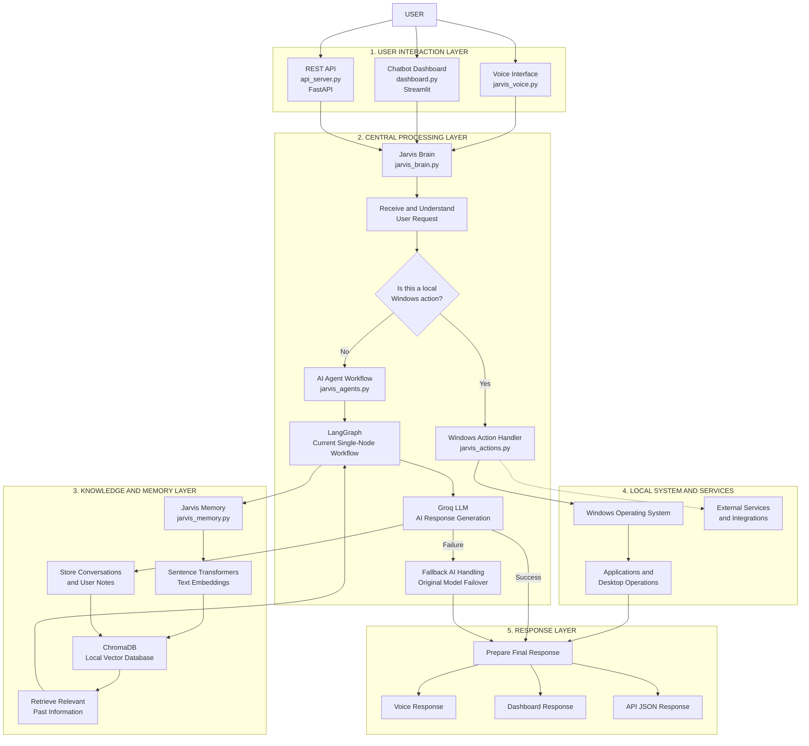
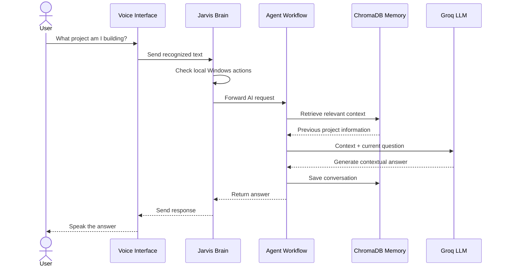
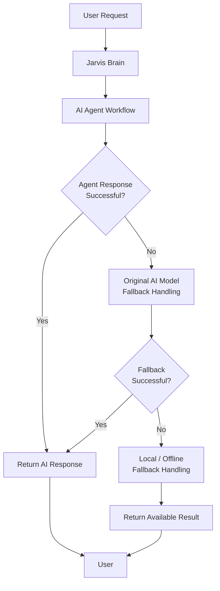
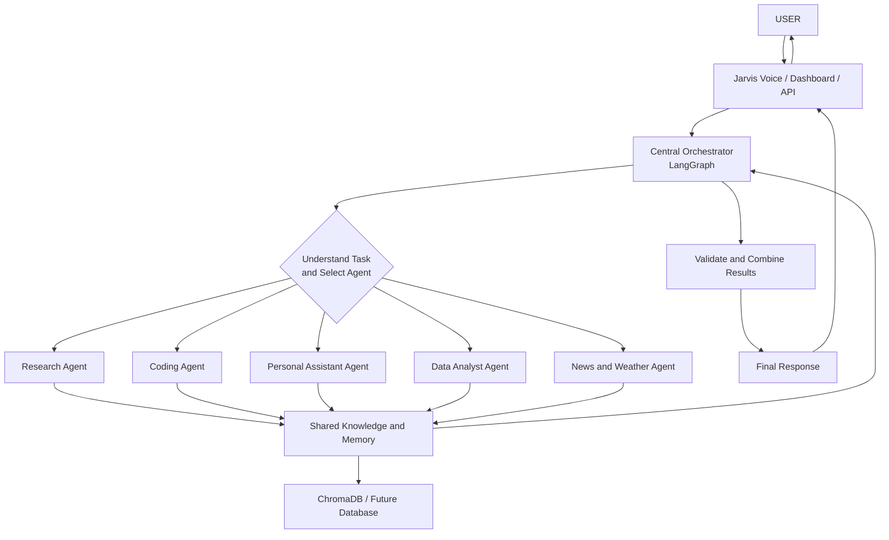

# ⚡ Jarvis AI – Personal Voice Assistant

An AI-powered personal assistant designed to interact with users through voice, chat, and APIs. Jarvis combines cloud-based AI intelligence with local Windows automation, conversational memory, and a modular backend.

The goal is to build a smart personal assistant that can understand requests, perform supported computer operations, remember useful information, and assist with everyday tasks.

---

## 📌 Project Overview

Jarvis is built using Python and integrates Groq-powered AI, LangGraph, ChromaDB, FastAPI, and Streamlit.

It follows a hybrid architecture:

- **Cloud AI:** Processes natural-language requests and generates intelligent responses.
- **Local Windows Automation:** Executes supported desktop and application operations.
- **Conversational Memory:** Stores conversations and notes locally for contextual retrieval.
- **Multiple Interfaces:** Supports voice interaction, a chatbot dashboard, and REST API access.

## ✨ Key Features

- 🎙️ **Voice Interaction:** Communicate with Jarvis using voice commands.
- 🧠 **AI-Powered Conversations:** Generate responses using Groq-hosted language models.
- 💻 **Windows Automation:** Open supported applications and perform supported desktop actions.
- 🗂️ **Long-Term Memory:** Store and retrieve relevant conversations using ChromaDB.
- 🔍 **Semantic Search:** Use Sentence Transformers to find relevant information from stored memory.
- 🔄 **AI Fallback Handling:** Handle model failures and rate limits through fallback logic.
- 🌐 **REST API:** Access Jarvis functionality through FastAPI.
- 💬 **Chatbot Dashboard:** Interact with Jarvis through a Streamlit web interface.
- 📈 **Market Information:** Retrieve stock-market information through the existing market module.
- 🎨 **Holographic Interface:** Existing Jarvis workplace interface with a futuristic HUD design.

---

# 🏗️ System Architecture

Jarvis follows a modular architecture in which each component has a specific responsibility.

## 1. Complete Architecture Flowchart

The following diagram explains how a request travels through Jarvis, from user interaction to processing, memory access, execution, and the final response.



## 2. Understanding Each Architecture Layer

### Layer 1 – User Interaction

Users can communicate with Jarvis through three interfaces:

| Interface | File | Purpose |
|---|---|---|
| Voice Interface | `jarvis_voice.py` | Voice-based interaction |
| Chatbot Dashboard | `dashboard.py` | Web-based chat interface |
| REST API | `api_server.py` | Programmatic access |

All three interfaces connect to the central Jarvis Brain.

### Layer 2 – Central Processing

The central processing component is `jarvis_brain.py`.

It receives the user's request and determines how to process it.

**Local Windows request:**
- Calls `jarvis_actions.py`.
- Executes a supported local operation.
- Returns the result.

**AI-related request:**
- Calls `jarvis_agents.py`.
- Runs the current LangGraph workflow.
- Uses Groq for AI response generation.
- Uses fallback handling if the agent workflow encounters an error.

### Layer 3 – Knowledge and Memory

The memory system is managed by `jarvis_memory.py`.

It uses:

- **Sentence Transformers:** Converts text into numerical embeddings.
- **ChromaDB:** Stores conversation and note embeddings locally.
- **Semantic Retrieval:** Finds relevant information from previous interactions.

This allows Jarvis to retrieve useful context when responding to later requests.

### Layer 4 – Local System and External Services

The `jarvis_actions.py` module handles supported Windows operations, such as launching applications and performing supported desktop tasks.

External services can also be integrated through APIs.

### Layer 5 – Response Generation

After processing the request, Jarvis returns the result through the original interface:

- Voice output through the voice interface.
- Text output through the Streamlit dashboard.
- JSON output through the FastAPI backend.

---

## 3. Example – How Jarvis Processes a User Request

Consider this example:

**User:** "Jarvis, what project am I currently building?"

The following flow explains how Jarvis can use conversational memory to answer.



This example demonstrates how the AI workflow and memory system work together to provide contextual responses.

---

# 🧰 Technology Stack

| Category | Technology | Responsibility |
|---|---|---|
| Programming Language | Python | Core development |
| AI Model Provider | Groq API | AI response generation |
| Agent Framework | LangGraph | Workflow orchestration |
| Embedding Model | Sentence Transformers | Text embeddings |
| Vector Database | ChromaDB | Local memory storage |
| Backend Framework | FastAPI | REST API |
| Data Validation | Pydantic | API request validation |
| Frontend Dashboard | Streamlit | Chat interface |
| Voice Interaction | Python voice modules | Speech interaction |
| Testing | pytest | Automated testing |
| Version Control | Git & GitHub | Source code management |

---

# 📂 Project Structure

```text
Jarvis-AI-Personal-Assistant/
│
├── jarvis_voice.py
├── jarvis_brain.py
├── jarvis_actions.py
├── jarvis_market.py
│
├── jarvis_agents.py
├── jarvis_memory.py
│
├── api_server.py
├── dashboard.py
│
├── jarvis_workplace.html
├── Jarvis_Setup_Guide.html
├── Jarvis_Setup_Guide.pdf
│
├── requirements.txt
├── requirements-additions.txt
├── install.bat
├── install.sh
│
├── README.md
├── INDEX.md
├── .gitignore
│
├── data/                  # Local ChromaDB data
├── tests/                 # Automated tests
└── .venv/                 # Python virtual environment
```

**Note:** Local memory data, virtual environments, API keys, and backup files are excluded from GitHub through `.gitignore`.

---

# ⚙️ Installation and Setup

## Prerequisites

- Windows 10/11 or a compatible operating system
- Python 3.10 or later
- Git
- Groq API key

## Step 1 – Clone the Repository

```bash
git clone https://github.com/sahithi-gullapalli/Jarvis-AI-Personal-Assistant.git
```

```bash
cd Jarvis-AI-Personal-Assistant
```

## Step 2 – Create a Virtual Environment

```bash
python -m venv .venv
```

Activate it on Windows:

```bash
.venv\Scripts\activate
```

## Step 3 – Install Dependencies

Install the original project dependencies:

```bash
python -m pip install -r requirements.txt
```

Install the additional AI, memory, API, dashboard, and testing dependencies:

```bash
python -m pip install -r requirements-additions.txt
```

## Step 4 – Configure Groq API Key

Set your Groq API key as an environment variable.

Windows CMD:

```cmd
setx GROQ_API_KEY "your_groq_api_key"
```

Restart the terminal after setting the environment variable.

**Security:** Never commit API keys, passwords, or credentials to GitHub.

## Step 5 – Run Jarvis Voice Assistant

```bash
python jarvis_voice.py
```

## Step 6 – Launch the Chatbot Dashboard

Open another terminal, activate the virtual environment, and run:

```bash
streamlit run dashboard.py
```

The dashboard will be available at:

```text
http://localhost:8501
```

## Step 7 – Start the FastAPI Backend

Open another terminal and run:

```bash
uvicorn api_server:app --reload
```

API documentation:

```text
http://127.0.0.1:8000/docs
```

Available endpoints include:

| Endpoint | Method | Purpose |
|---|---|---|
| `/health` | GET | Check API health |
| `/ask` | POST | Submit a request to Jarvis |

---

# 🎙️ Example Voice Commands

| Command | Expected Action |
|---|---|
| Open VS Code | Launch Visual Studio Code |
| Play lofi | Open music playback |
| Give me stock market updates | Retrieve market information |
| Should I buy Reliance? | Request market-related analysis |
| Read my unread emails | Use the supported email briefing functionality |
| Send a WhatsApp message to Amma | Use supported WhatsApp automation |
| Volume up | Increase system volume |
| Mute | Mute system audio |

*Actual command support depends on the existing action handlers and integrations configured in the project.*

---

# 🔄 AI Fallback Architecture

Jarvis uses a hybrid approach to improve reliability.



This approach helps Jarvis handle AI errors, model availability issues, and rate limits without relying on a single processing path.

---

# 🔐 Security and Privacy

Security is an important consideration in Jarvis.

Current practices:

- API keys are managed through environment variables or the existing local key configuration.
- `.env` files and local credentials are excluded from Git.
- ChromaDB memory is stored locally.
- Local database files are excluded from the public repository.
- The FastAPI server is intended for local development.

**Future security improvements:**

- Authentication and authorization.
- Secure API key management.
- Input validation and request limits.
- Access control for sensitive desktop operations.
- Encrypted sensitive data storage.
- Audit logging and monitoring.
- Production-ready API deployment security.

---

# 🚀 Future Development – Multi-Agent AI Architecture

The current project provides the foundation for a more advanced multi-agent assistant.

The long-term vision is to introduce specialized agents that can independently handle different categories of tasks while coordinating through a central orchestrator.

## Proposed Multi-Agent Architecture



## Planned Specialized Agents

| Agent | Planned Responsibility |
|---|---|
| Research Agent | Research topics and summarize information |
| Coding Agent | Assist with coding, debugging, and development |
| Personal Assistant Agent | Manage daily tasks and supported system operations |
| Data Analyst Agent | Analyze datasets and generate insights |
| News and Weather Agent | Retrieve current news and weather information |

Additional planned capabilities include:

- Agent-to-agent communication.
- Task planning and delegation.
- Shared long-term memory.
- Gmail and additional third-party integrations.
- Advanced security and access control.
- Monitoring, evaluation, and performance optimization.

*These are planned enhancements, not claims about currently implemented functionality.*

---

# 🧪 Testing

The project includes a pytest-based testing foundation.

Run tests using:

```bash
python -m pytest
```

Testing goals include:

- Module import validation.
- API endpoint testing.
- Memory storage and retrieval.
- AI workflow validation.
- Local action handling.
- Error and fallback handling.

---

# 🎯 Project Vision

Jarvis is being developed as a modular personal AI assistant that combines cloud intelligence with local computer control.

The long-term objective is to evolve it into a secure, intelligent, multi-agent platform capable of assisting with research, software development, data analysis, daily activities, and real-time information retrieval.

---

# 👩‍💻 Developer

**Developed by:** Sahithi Gullapalli

**GitHub:** [sahithi-gullapalli](https://github.com/sahithi-gullapalli)

---

⭐ If you find this project interesting, feel free to explore the repository and follow its development.

**Jarvis AI – Your Personal Assistant. One Interface. Multiple Possibilities.**
